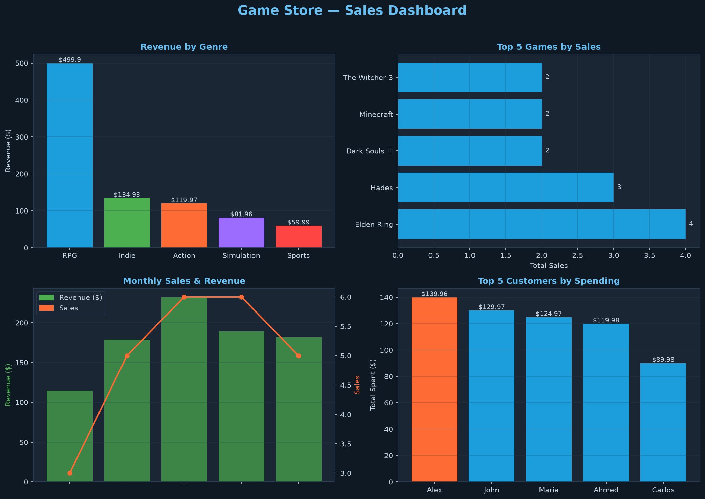

# 🎮 Game Store Analytics

A SQL analytics project built on a relational SQLite database of a fictional game store. Covers the full pipeline: database design, data population, analytical queries, and a visual dashboard.

## Project Structure

```
game-store-analytics/
├── create_db.py    # Creates the database and populates it with data
├── analytics.py    # SQL queries — answers real business questions
├── visualize.py    # Builds a 4-panel dashboard from query results
├── gamestore.db    # SQLite database (generated by create_db.py)
├── dashboard.png   # Output dashboard (generated by visualize.py)
└── README.md
```

## Database Schema

Three related tables connected by foreign keys:

```
games                        customers
─────────────────────        ──────────────────
game_id      PK              customer_id  PK
title                        name
genre                        country
developer                    age
release_year
price
                    purchases
                    ──────────────────────
                    purchase_id  PK
                    customer_id  FK → customers
                    game_id      FK → games
                    purchase_date
                    quantity
```

## Queries

`analytics.py` answers 7 business questions using progressively complex SQL:

| Query | Concepts used |
|---|---|
| Top 5 best-selling games | JOIN, GROUP BY, COUNT, ORDER BY |
| Revenue by genre | SUM, AVG, GROUP BY |
| Top 5 customers by spending | Multi-table JOIN, GROUP BY |
| Sales by month | STRFTIME, GROUP BY |
| Games with no sales | LEFT JOIN, WHERE IS NULL |
| Average customer age by genre | AVG, MIN, MAX |
| Customers above average spending | Subquery inside HAVING |

## Sample Results

**Revenue by genre**
```
genre         sales   total_revenue   avg_price
RPG           10      499.90          49.99
Indie         7       134.93          19.28
Action        3       119.97          39.99
Simulation    4        81.96          20.49
Sports        1        59.99          59.99
```

**Games with no sales**
```
title              genre    price
Counter-Strike 2   Action    0.00
Among Us           Indie     4.99
```

## Dashboard



Four panels: revenue by genre, top 5 games by sales, monthly sales trend, top customers by spending.

## Quick Start

```bash
# 1. Clone and install dependencies
pip install matplotlib

# 2. Create the database
python create_db.py

# 3. Run analytics
python analytics.py

# 4. Generate dashboard
python visualize.py
```

## Key concepts

- **Database design** — normalized schema with primary and foreign keys across 3 tables
- **JOINs** — combining data from multiple tables in a single query
- **Aggregation** — GROUP BY with COUNT, SUM, AVG to summarize data
- **Subqueries** — nested SELECT inside HAVING to filter against a dynamic threshold
- **LEFT JOIN + IS NULL** — finding records with no match in another table
- **Python + SQLite** — running SQL queries from Python and using results directly in matplotlib

## Tech stack

`Python` · `SQLite` · `matplotlib`
